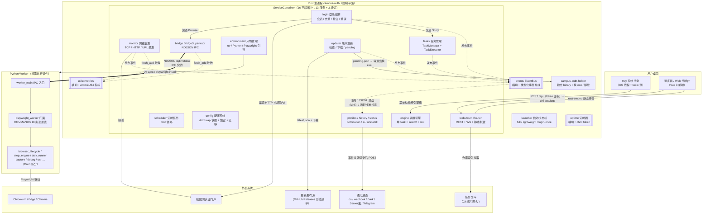
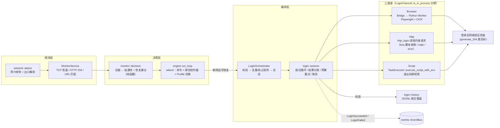
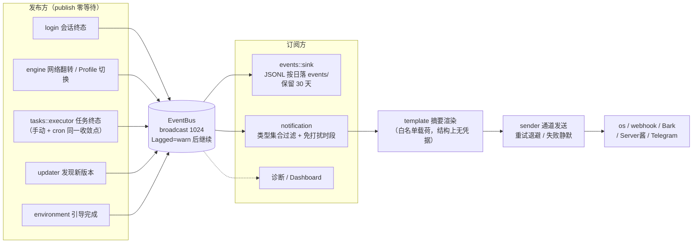
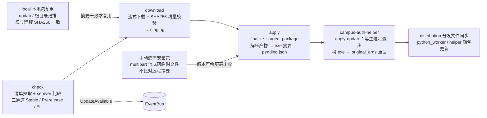
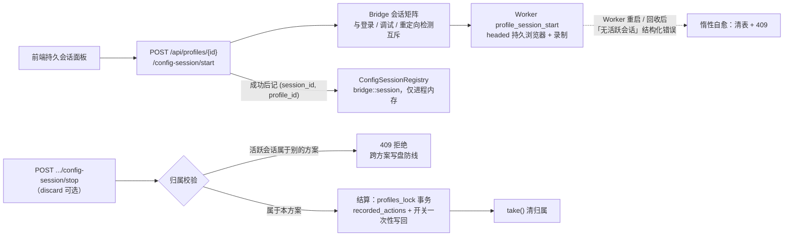
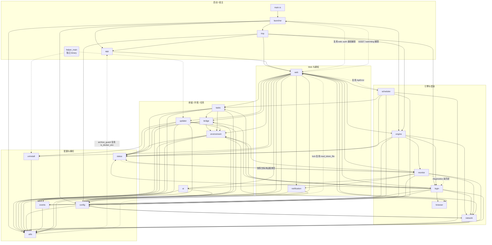

# 架构总览与模块地图

> **生成基准**：commit `3ae95d1`（2026-11-13，v5.2.0-beta.1），A46 后收尾复核至 `0c707f1`。本文记录代码的**实际**结构与依赖方向；重构后模块边界以代码为准——发现本文与 `src/` 现状不符时，以代码为准并按文末「维护约定」更新本文。
>
> **与 `AGENTS.md` 的分工**：本文管**依赖关系与数据流**（谁引谁、数据怎么走）；`AGENTS.md` 项目结构节管**构建命令 / 代码规范 / 常见陷阱**，不重复此处内容。

## 目录

- [1. 整体拓扑](#1-整体拓扑)
- [2. 关键数据流](#2-关键数据流)
- [3. 模块地图：src/](#3-模块地图src)
- [4. 模块地图：python_worker/](#4-模块地图python_worker)
- [5. 模块地图：frontend/](#5-模块地图frontend)
- [6. 模块依赖图](#6-模块依赖图)
- [7. 测试地图](#7-测试地图)
- [8. 维护约定](#8-维护约定)

---

## 1. 整体拓扑

单 binary crate + 按需 Python 子进程 + 嵌入式前端。Rust 主进程是控制平面（监测 / 状态机 / 调度 / 配置 / Web API / 托盘），Python Worker 是按需执行插件（Playwright 浏览器自动化 + ddddocr OCR），前端经 `rust-embed` 编译进二进制由 axum 静态托管。

### 容器拓扑口径

`src/container.rs` 的 `ServiceContainer` 共 **16 字段**：13 服务（config / profiles / history / tasks / status / bridge / environment / executor / login / scheduler / monitor / updater / engine 槽）+ 3 横切（`EventBus` / `Metrics` / `uptime_cancel`）。构造严格按依赖拓扑排序；`startup()` 另行启动 4 个后台任务（EventSink 落盘 / 推送通知 / Scheduler 循环 / Bridge 主循环），句柄交 Launcher 统一管理。`Engine` 是可崩溃重启特例：`EngineSlot`（`Arc<ArcSwapOption<EngineHandle>>`）承接 watch 崩溃重启后的原子换入，Web / 托盘 / 关闭流程一律经槽取「当前活跃」Engine。可启停后台服务统一 `ServiceHandle`（watch stop_tx + JoinHandle）模式。

---

## 2. 关键数据流

### 2.1 登录链（监测 → 引擎 → 编排 → 三渠道）

- 判定「要不要 Python 环境 / 占不占浏览器槽位 / 能否取消 Bridge 任务」一律走 `LoginChannel::is_in_process()`（仅 Browser 为假）；脚本渠道复用 `TaskExecutor`，凭据只经 `CAMPUS_*` 环境变量下发。
- 去重/抢占优先级：`LoginOnce(4) > Browser(3) > Manual(2) > Auto(1)`，组合空间由属性测试钉住。
- 探测不内联进 Engine 主循环：`check_auto_monitor` 移入独立 task，结果经 mpsc 回传，命令通道保持即时响应。

### 2.2 事件流（源头 → 总线 → 落盘 / 通知）

- 事件载荷是**白名单式摘要设计**：凭据 / token / URL 查询串在结构上就不存在对应字段，写入层不做二次脱敏（信任链在事件类型设计上）。
- 通知发送失败只 warn 留痕，绝不影响登录主链路；系统通知是阻塞 IO，包在 `spawn_blocking` + 超时里。

### 2.3 更新链（检查 → 下载 → pending → helper 替换）

- 两条手动入口信任口径不同：本地包复用**必须**与远程清单摘要一致；手动上传**不比对**远程摘要（自编译包必不匹配），但硬约束 target 恒取 `current_exe()`、版本严格高于当前。
- 共同点：落盘均走 `finalize_staged_package`，无旁路；`cancel_pending_update`（卸载流程）经状态临界区标记 + 操作互斥阻止在途操作重新提交。
- 启动时后台 `apply_pending_on_startup`（2s 错峰）应用待定更新，与手动 apply 共用 `update_in_progress` 原子互斥。

### 2.4 配置会话链（跨方案写盘防线）

- 占用互斥以 **Worker 侧为权威**（重复 start 回结构化错误 → 409）；Rust 会话矩阵把 `profile_session_start/stop` 归为持久类命令，在途登录 / 调试 / 重定向检测期间快速失败（同 `profile_auto_login` 口径）。
- **归属注册表是跨方案写盘的唯一防线**：Worker 不感知方案 id，start 成功后 Rust 把 `(session_id, profile_id)` 记入 `ConfigSessionRegistry`（`bridge/session.rs`，BridgeSupervisor 持有）；stop 端点**先**做归属校验，「会话属于别的方案」一律 409——A 方案的录制永不写进 B 方案。
- 非 discard 结算走与 `PUT /api/profiles/{id}` 同一 `profiles_lock` 事务（`recorded_actions + persistent_session_enabled=true` 一次性写回，并发保存不丢字段）；discard 仅关浏览器不落盘录制。
- 陈旧归属惰性自愈：Worker 重启 / 回收后 stop 收到「无活跃会话」结构化错误 → 清表 + 409；`force_recycle` 强杀 Worker 时同步清表。
- start 前编排侧 ensure `browser_profiles/<id>/`（`utils::paths::browser_profile_dir`），仅浏览器渠道支持（直连 / 脚本渠道无浏览器会话可录，400）。

---

## 3. 模块地图：src/

按目录盘点（拆分潮后现状）。**依赖方向**一列为「本目录 `use crate::` 引用了谁」，箭头指向被依赖方；逆序即「被谁引用」可从第 6 节依赖图读。

### 3.1 入口与横切文件

| 文件 | 职责 | 依赖方向 |
|------|------|---------|
| `src/main.rs` | CLI 解析 → 启动分发（Windows release 为 GUI 子系统） | → launcher |
| `src/lib.rs` | 库入口：聚合全部模块 + 统一 `ServiceHandle` | → 全部模块 |
| `src/helper_main.rs` | 独立 binary `campus-auth-helper`：`--apply-update` 等主进程退出后换 exe；`--uninstall` 等退出后删安装目录（Windows 两段式经 `%TEMP%`） | → updater / uninstall / environment / utils |
| `src/container.rs` | `ServiceContainer` 16 字段拓扑构造 + DI 容器 + 后台任务 spawn | → 几乎全部服务（唯一组装点） |
| `src/app.rs` | Axum 服务器构建、端口绑定回退、按需启停 | → web / container / utils |
| `src/browser.rs` | 浏览器可用性探测与渠道自动选择（系统渠道 + Playwright 管理渠道） | 独立（供 environment / login / web 共用） |
| `src/logging.rs` | 日志初始化 / 动态级别 / WS 广播 Layer（直接从 metadata 构造 LogEntry） | 独立（被 launcher / web 消费） |

### 3.2 服务目录

| 目录 | 职责（一行） | 依赖方向 |
|------|------------|---------|
| `launcher/` | 启动状态机：配置合并 → 锁 → 模式分发 → Engine 崩溃恢复 → 优雅关闭 | → app / container / config / utils / logging / engine / tray(desktop) / network / status / web（auth 辅助） |
| `engine/` | 调度引擎单 task：`commands`（EngineCommand 枚举）+ `run_loop`（select! 主循环，墙钟分界）+ `slot`（可替换句柄槽） | → login / monitor / config / status / events / network |
| `login/` | 登录编排：`session`（尝试循环状态机）/ `preemption`（去重抢占矩阵）/ `http_login`（直连执行器）/ `script_login`（脚本渠道）/ `history`（JSONL）/ `ruijie`·`srun`（门户专用纯算法） | → bridge / tasks / config / status / events / network / environment / browser / utils |
| `bridge/` | Python Bridge：`mod`（Supervisor select! 主循环）/ `ipc`（NDJSON 协议）/ `process`（子进程 + 行解析）/ `session`（会话互斥 + cancel 注册表）/ `state` / `api`（Web 注入的 trait）/ `lifecycle`（懒加载 spawn / 空闲回收）/ `debug`（调试会话结算）/ `job`（Windows Job Object）/ `orphan`（孤儿 chromium 清理）/ `worker`（状态机）/ `error` / `test_support` | → status / environment / config / utils |
| `environment/` | 环境管理器：`bootstrap`（两阶段引导）/ `browser_registry`（Playwright registry 判定，与 Python 侧双端一致）/ `health`（Worker 探测 + 依赖指纹）/ `python`（venv + Playwright 安装）；子目录 `uv/`：`download`（镜像测速流式下载）/ `verify`（实启校验 + SHA256）/ `sync`（uv sync + OCR 依赖交接）/ `process`（取消超时受控子进程） | → status / events / utils（io_human / paths）/ browser（系统渠道就绪判定） |
| `tasks/` | 任务管理：`loader`（TaskManager，browser/scripts/http 三桶 CRUD）/ `executor`（TaskExecutor 统一入口：Browser→Bridge、Script→子进程，终态事件收敛点）/ `models`（三类任务 serde 模型） | → bridge / environment / config / status / events / utils（io_human） |
| `monitor/` | 网络监测：`probes`（三类探测）/ `decision`（证据→状态纯函数）/ `model` / `portal`（门户重定向检测）/ `diagnostics`（一键诊断，Web 层按需构造不入容器） | → network / status / config / utils / login（diagnostics 读登录历史）/ ai·environment·notification（diagnostics 复用 LLM 配置、环境状态与 URL 脱敏） |
| `network/` | 网卡检测与出口：`detect`（三平台探测器）/ `interfaces`（虚拟网卡过滤）/ `adapters` / `egress`（按方案绑定出口，不回退）/ `settings` | → config（ProfileData / GlobalConfig 类型）/ utils（io_human）；被 monitor / login / engine 消费 |
| `config/` | 配置系统：`schema`（serde 数据模型 + JsonSchema 快照）/ `service`（ConfigService，双域互斥锁 + ArcSwap 快照）/ `runtime`（RuntimeConfig 合并快照）/ `profiles`（ProfileService）/ `migration`（v5→v10 幂等管线）/ `crypto`（AES-256-GCM） | → utils / network（NetworkSettings 类型复用）/ notification（schema 示例渲染） |
| `scheduler/` | 定时任务：`cron_loop`（5→7 字段转换 + 分片睡眠抗休眠唤醒）/ `task`（ScheduledTask 模型 + 历史） | → config / tasks / status / events / utils（io_human / paths）/ web（复用 ApiError） |
| `status/` | 状态管理：`snapshot`（StatusSnapshot / PartialSnapshot）/ `notifier`（失败通知去重）；StatusManager watch 推送 | → monitor（快照含探测证据类型） |
| `notification/` | 推送通知：`filter`（类型集合 + 免打扰时段纯函数）/ `template`（脱敏摘要渲染）/ `sender`（五通道发送 + 退避） | → events / config |
| `events/` | 内部事件总线：`bus`（broadcast 1024）/ `sink`（JSONL 按日落盘 + 30 天保留）；`AppEvent` 白名单载荷 | 自洽（被 8 处发布方 / 消费方引用） |
| `updater/` | 版本更新：`check`（清单 + 通道）/ `download`（流式 + 增量摘要）/ `apply`（pending.json）/ `local`（本地包复用）/ `operation`（取消不释放所有权）/ `distribution`（随包分发同步）/ `version_info`（PE 版本解析）/ `error` | → config / status / events / utils / uninstall / environment（RESYNC_MARKER） |
| `web/` | Web 层：`auth`（token + bootstrap 握手）/ `host`（DNS rebinding 防线）/ `ssrf`（解析钉扎）/ `openapi`（utoipa 契约管线：已注解域 spec 与手写 baseline 按路径合并生成 `openapi.json`，route_table 单一来源 ↔ 产物双向校验）/ `error`（信封）/ `state`（AppState 细粒度注入）/ `operations`（长操作登记）/ `static_files` / `ws`；`routes/` 按域拆分 20 个文件（config / profiles / login / http_tasks / monitor / scheduler / tasks / scripts / tools / system / autostart / debug / history / repo / background / uninstall / ocr / ai / notification / diagnostics / …） | → 全部服务（经 container 与细粒度 Api trait） |
| `ai/` | AI 任务生成：`llm`（OpenAI 兼容客户端）/ `prompt`（schema 提示词）/ `generate`（生成编排 + 强校验回喂）/ `error` | → config（加密凭据）/ utils |
| `tray/` | 系统托盘（`desktop` feature）：OS 线程极简 + tokio 泵任务承载业务 | → app / container / engine / config / status / web / login（LoginApi 直发登录）/ utils |
| `uninstall/` | 卸载计划**单一事实源**：删什么 / 拒什么 / 怎么删（界面与 helper 共用） | → utils（paths 布局常量） |
| `utils/` | 跨切面工具：`paths`（运行时目录布局单一事实源）/ `lock`（实例文件锁）/ `metrics`（AtomicU64）/ `io`（原子写）/ `io_human`（人话化 IO 错误文案）/ `archive_guard`（未解压运行拦截）/ `platform` + `platform_windows` / `platform_macos`（自启动） | 近乎最底层：仅 std + 两处上行辅助（`archive_guard` 复用 `app::is_docker_env`、`lock` 关机通知复用 `web::auth::read_token_file`；`config` / `environment` 等反向依赖它） |

---

## 4. 模块地图：python_worker/

执行侧插件：`worker_main.py` 是 IPC 入口（stdin 读取线程 + 主循环），`playwright_worker.py` 是**门面**——伴生模块以 Mixin 多继承组装回 `WorkerCore`，命令注册表 `COMMANDS`（18 条）在此收敛为单一事实源。拆分纪律：**纯逻辑层与页面 IO 编排分离**（`config_session` / `auto_login` / `debug_session` / `ocr_runtime` / `models` / `variable_resolver` 不依赖 Playwright，可直接单测）。

| 模块 | 职责 | 备注 |
|------|------|------|
| `worker_main.py` | IPC 入口：NDJSON 请求分发 + cancel 通知触达 + 退出协议 | stdout 是 IPC 通道，日志只走 stderr |
| `playwright_worker.py` | 门面：Mixin 组装 + `COMMANDS` 单一注册表（18 条） | 与 README 命令表逐项对应 |
| `browser_lifecycle.py` | start / close / keep_alive / 空闲回收 / 生命周期锁 | 驱动真实页面 IO |
| `browser_launch.py` | 启动参数构建、launcher 解析、stealth / 直连 / 资源路由 | 承载跨模块契约常量 |
| `browser_detect.py` | 浏览器 registry 判定与系统渠道探测 | 语义须与 Rust `environment::browser_registry` 双端一致（两端各有测试） |
| `step_engine.py` | `run_steps`、失败归一、首导航解析 | 纯编排，page 由调用方注入 |
| `step_handlers.py` | 各步骤类型的处理器实现 | 被 step_engine 分派 |
| `task_runner.py` | `_run_task` + cookie 清理矩阵 + `execute_*` 命令 | ensure 浏览器 → 会话页 → run_steps → success_condition |
| `profile_commands.py` | `profile_session_*` / `profile_auto_login` 命令编排 | 驱动真实页面 IO |
| `config_session.py` | 持久配置会话**纯逻辑**：会话状态、录制汇聚器、录制器 JS | 无 Playwright 依赖 |
| `auto_login.py` | 持久自动登录**纯逻辑**：录制动作校验与回放映射 | 无 Playwright 依赖 |
| `capture_commands.py` | 捕获与探测命令：test_redirect / page_capture / feedback_capture | 临时浏览器自包含 |
| `capture_kit.py` | 页面结构摘要 + CSS/JS 资源快照工具箱 | 供 AI 任务生成与反馈链路 |
| `debug_commands.py` | 调试会话 `debug_*` 命令编排 + 截图治理 | 页面 IO |
| `debug_session.py` | 调试会话**纯状态机**：DebugSession 数据类 + steps_info | 无 Playwright 依赖 |
| `ocr_commands.py` | `ocr_recognize` 编排：总预算两阶段超时与取消 | 页面 IO |
| `ocr_runtime.py` | ddddocr 实例缓存、图片预处理、单次推理超时 | 无 Playwright 依赖；按需能力 |
| `cancel_registry.py` | cancel_id → threading.Event 跨线程映射 | 模块级单例 |
| `worker_paths.py` | 产物路径锚定（截图 / 捕获 / 持久数据）+ 启动残留清理 | 不依赖 spawn 继承的 CWD |
| `models.py` | IPC 数据模型 | 字段与 Rust `tasks/models.rs` + `config/schema.rs` 严格对齐 |
| `variable_resolver.py` | `{{VAR}}` 模板变量解析（链式引用） | 浏览器任务专属 |

---

## 5. 模块地图：frontend/

Vue 3 + TypeScript + Vite。分层单向依赖：`views` → `components` / `composables` → `api` → `client.ts`；业务代码禁止直接 `fetch`。

| 层 | 内容 | 职责 |
|----|------|------|
| `api/` | `client.ts` / `index.ts` / `types.ts` / `generated/api.d.ts` | fetch 封装（自动解包 `{data}` 信封 + bootstrap 握手鉴权）、端点函数集合、**手写契约类型 `types.ts`**（业务消费唯一来源）；`generated/api.d.ts` 由 `npm run typegen` 从 openapi.json 生成（`typegen:check` 钉一致性），生成物暂未被业务代码消费、待逐步接管 |
| `composables/` | `useConfig` / `useProfiles` / `useTasks` / `useWebSocket` / `useUpdateDialog` 等 30+ | 页面级状态组合（加载 / 草稿 / 轮询 / WS 订阅） |
| `components/` | `common/`（Modal / Toast / SetupWizard / CommandPalette …）+ 面板组件（DebugPanel / NetworkDiagnosticsPanel …） | 跨视图复用 UI |
| `views/` | DashboardView / TasksView / ProfilesView / SettingsView / AiTaskView 等（`views/settings/` 分区设置页、`views/tasks/` 四任务面板） | 路由页面 |
| `router/` | `index.ts` | 路由表 |
| `utils/` | `loginChannel.ts`（渠道与 `CAMPUS_*` 环境变量契约，有测试钉住）/ `guards.ts` / `formatters.ts` / `repo*.ts` / 草稿类 | 纯函数工具 |
| `styles/` | `base` / `layout` / `components/` / `pages/` / `responsive` + `tokens.test.ts` | 共享样式分层（新代码归属判据见 `styles/index.css` 文件头） |

---

## 6. 模块依赖图

按实际 `use crate::` 关系绘制（grep 佐证主要依赖边，细粒度 handler 注入见 `web/state.rs`；同名互引 / 测试内部引用不画）。方向：**箭头 = 「引用」**，指向被依赖方；`utils` 为最底层。

> 读图要点：`config` / `status` / `events` / `utils` 是四块公共底座，被所有域引用（图中仅画代表性边，避免蜘蛛网）；`utils` 近乎最底层，仅两处上行辅助复用（虚线：`archive_guard → app::is_docker_env`、`lock → web::auth::read_token_file`）；`web` 是唯一几乎全知的位置（经 `AppState` 的细粒度 Api trait 注入，不直触内部状态）；`events` 本身不依赖任何业务模块（发布方与订阅方互不感知）；`helper_main` 是独立 binary，经 `updater` / `uninstall` 共享 pending 契约与删除清单；测试模块内部的引用（如 engine 测试注入 Bridge/TaskManager 假件、monitor 诊断夹具引 ai）一律不画。

---

## 7. 测试地图

| 层级 | 位置 | 钉住什么 |
|------|------|---------|
| **单元测试**（`#[cfg(test)]`） | `src/` 各模块内 | 模块内逻辑：config 读写与 schema 快照、migration 幂等、monitor::decision 判定、notification::filter 免打扰、scheduler cron 归一、updater local 摘要校验、web routes handler、utils paths 布局钉住（`test_data_dir_names_match_paths`）等 |
| **属性测试**（proptest） | `src/bridge/process.rs`、`src/login/preemption.rs`、`src/login/session.rs`、`src/login/mod.rs`、`src/config/migration.rs`、`src/web/routes/config.rs` | IPC 行解析、去重/抢占决策矩阵组合空间、会话结果分类、迁移幂等、`PATCH /api/config` 载荷归一 |
| **集成测试**（`assert_cmd`） | `tests/*.rs` | `smoke_test`（二进制启动/版本）、`instance_lifecycle`（锁互斥、端口回退、优雅关闭、lightweight/login-once）、`bridge_ipc`（假 Worker NDJSON roundtrip）、`bridge_supervisor`（Supervisor 状态机 + 熔断）、`scheduled_tasks`（定时任务 API 面）、`updater_channels`（三通道清单选取与回退）、`updater_recovery`（启动兜底完整分发）、`http_login_chain`（直连渠道全链路，免 Python） |
| **E2E 登录链** | `tests/login_chain.rs`（CI job `e2e-login-chain`） | mock 门户 → 真实二进制 → Worker（Playwright + OCR）→ success_condition → 历史落盘；验证码失败重试（mock `/failonce`） |
| **mock 门户** | `tests/mock-servers/`（captive / captcha-mock / eportal-xor / eportal-fnv1a-b64 / full-portal / portal-v2） | 直连加密协议复刻、三级 302 跳转链、验证码注入、环回跳转陷阱 |
| **真浏览器** | `python_worker/tests/test_auto_login_browser.py` | 真 chromium 驱动持久上下文自动登录回放 |
| **Python 单测**（pytest） | `python_worker/tests/*.py` | 步骤契约回归（`test_step_contract_regressions` / `test_step_timeout_budget`）、任务契约、变量解析、stdin 读取、Worker 鲁棒性、config_session / debug_session / ocr_runtime 纯逻辑层 |
| **Fuzz**（3 target） | `fuzz/fuzz_targets/` | `fuzz_config_json`（SettingsData / ProfileData 任意 JSON 不 panic）、`fuzz_migrate`（迁移管线）、`fuzz_parse_ipc`（NDJSON 解析链全反序列化面） |
| **覆盖率门禁**（CI `coverage`） | `.github/workflows/ci.yml` | `cargo llvm-cov --lib` 按域分组（config / login / engine / updater）行覆盖率阈值断言，阈值 = 实测基线 −4pp（防回退、容忍跨平台抖动，调阈值流程见 job 注释） |
| **前端**（vitest） | `frontend/src/**/*.test.ts` | composables / utils 纯函数（loginChannel 契约、configRanges、draftReconcile）、组件行为、styles tokens |
| **跨端一致性** | Rust 与 Python 各自测试 | `browser_registry` 判定语义双端一致（任一侧漂移都被测试抓到） |

> 验证强度按风险分级（见 `AGENTS.md` 测试规范）：低风险修复默认只跑相关单元测试 + 类型检查；并发 / 数据损坏 / 自更新 / 安全边界才升级到集成与 E2E。

---

## 8. 维护约定

1. **新增模块目录 / 拆分子模块时同步本文**：第 3–5 节的目录表、第 6 节依赖图（至少补主干边）。依赖边用 `grep -rn 'use crate::' <dir>/` 佐证后画入。
2. **职责一句话原则**：每个目录一行职责，超过一段说明该目录该拆了——参考历史上 `launcher.rs` / `bridge/mod.rs` / `playwright_worker.py` 的拆分潮。
3. **数据流变更**（登录渠道、事件变体、更新链入口）除本文外，记得同步 `AGENTS.md` 对应节（登录渠道 / Updater / 前端嵌入等）。
4. **分工不变**：本文管依赖关系与数据流；构建命令 / 代码规范 / 常见陷阱仍在 `AGENTS.md`；用户操作说明在 `docs/guides/` 其余指南。
